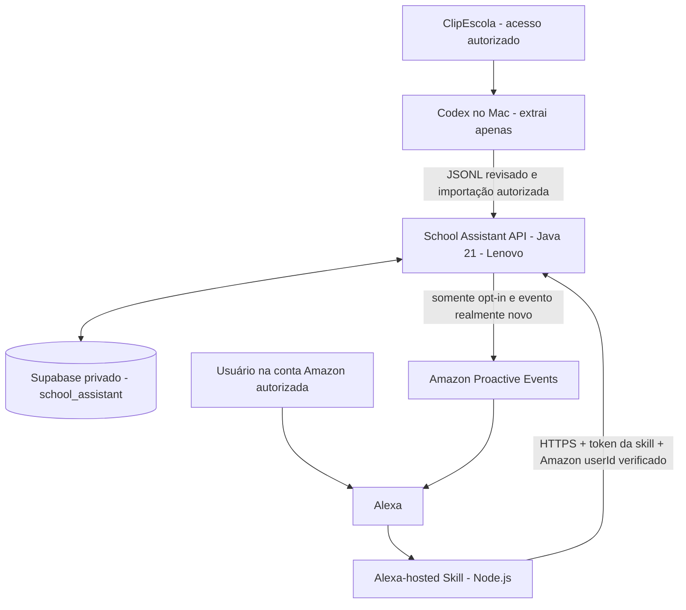

# Handoff operacional — School Assistant + Alexa + Lenovo + Codex
**Atualizado em:** 2026-11-17  
**Escopo:** MVP familiar, uma API Java no Lenovo, uma skill Alexa-hosted, banco Supabase isolado e extrator ClipEscola somente no Mac.  
**PR:** #1, branch `feat/school-assistant-mvp` (draft; não fazer merge nem disparar Actions sem aprovação).

## Decisão de arquitetura

- **Uma única API** é responsável por dados escolares, controle de família, importação, revisão e fila de notificações. A skill traduz comandos de voz; **não lê o GitHub nem acessa o Supabase**.
- Não implementar login de usuários da Bravum nesta fase. Administrador/ingestão usam credenciais M2M; skill usa segredo diferente e vínculo de conta Amazon com responsável/família.
- O `userId` da Amazon corresponde à **conta Amazon**, não prova quem está falando. Voice Profiles/identificação por voz não devem ser tratados como autenticação individual. Em dispositivos compartilhados, qualquer pessoa próxima pode solicitar informações faladas. Limitar respostas a títulos/contagens e não divulgar detalhes sensíveis na voz até avaliação explícita de privacidade.
- ChatGPT como cliente direto fica fora do caminho crítico do MVP; manter o serviço desacoplado para integrar mais tarde, sem custos OpenAI API ou MCP agora.

## Situação confirmada do código (não confundir com funcionamento real)
| Entrega | Estado | Evidência / limite |
|---|---|---|
| API Spring Boot e persistência PostgreSQL | Código no PR #1 | Não compilado/testado por Maven até o momento |
| Rotas Alexa: pareamento, resumo, recados, tarefas, consentimento | Código no PR #1 | Não testado com conta/skill reais |
| Skill custom pt-BR (ASK SDK) e modelo de voz | Código em `alexa-skill/` | Não cadastrada na Amazon |
| Proactive Events para novos comunicados | Worker e outbox codificados | `ALEXA_NOTIFICATIONS_ENABLED=false` por padrão; nenhum envio |
| Supabase `school_assistant` | 18 tabelas base + 4 privadas `alexa_*` | Sem dados reais importados; nenhuma linha nos conjuntos verificados |
| Privacidade dos comunicados históricos | Revisão e filtro implementados | Exige validação em execução antes do uso |
| Lenovo/HTTPS | Usuário decidiu publicar manualmente | Nenhum deploy ou endpoint público testado nesta etapa |
| Codex Mac | Extração isolada, fora da programação Bravum | Sem ingestão ao banco e sem prova de push do ClipEscola |

## Retorno do extrator ClipEscola (dados REAIS, nunca inserir no repositório)
- Evidências históricas: **11 comunicados reais** (10 `GENERAL_NOTICE`, 1 `SCHOOL_EVENT`) e **1 atividade possível**; não representam novas publicações da sessão atual.
- Contextos atuais: dois contextos efêmeros, **zero cartões** na captura ao vivo. O feed respondeu 200 às requisições observadas, mas isso não demonstra novos conteúdos.
- **Zero identificadores estáveis de alunas**, **zero prazos de entrega comprovados**, **zero URLs de anexos preservadas**. Contextos `UNCONFIRMED`.
- `contentComplete=false` quando não há confirmação inequívoca de completude. Não atribuir aluna por posição 0/1; não inferir data de entrega de publicação.
- Os JSONL originais são material sensível privado e ficam no Mac. **Não publicar conteúdo real, capturas, cookies, headers, tokens, IDs pessoais ou URLs privadas no GitHub**.
- Registros históricos não podem disparar 11 notificações novas. A API exige revisão + aluna identificada para consulta por voz e, para avisos, aceita apenas eventos realmente novos e verificados, com opt-in. Nunca marcar um backfill como `VERIFIED_LIVE_EVENT`.

## Trabalho paralelo INDEPENDENTE dos dados do Codex
### A. Validar backend, banco e segurança
- [ ] Compilar Java 21 e executar os testes Maven em ambiente autorizado, sem GitHub Actions.
- [ ] Testar `/api/v1/actuator/health` e conectar apenas ao projeto Supabase separado.
- [ ] Validar autenticação: ausência de chave 401; token da Alexa não executa administração; vínculo inexistente 403; tenant cruzado 403; tentativas de códigos, expiração, revogação e reuso.
- [ ] Testar isolamento da família, consultas vazias, revisão de comunicado sem destinatária (deve recusar), histórico sem alertas e importação duplicada idempotente.
- [ ] Revisar riscos de simultaneidade/retry na fila antes de habilitar saída para a Amazon.
- [ ] Revisar RLS das **18 tabelas base** antes de qualquer acesso de cliente público. Atualmente sem RLS, mas `anon` e `authenticated` estão sem `USAGE` no schema e privilégios de tabela; **não considerar que RLS já está ativo**. Não mudar RLS sem avaliação de papéis/impacto.

### B. Skill Alexa (sem depender do Codex)
- [ ] Executar testes de contrato Node.js e validar modelo de interação pt-BR; corrigir problemas encontrados.
- [ ] Validar intents de recados, resumo, tarefas de hoje/amanhã, vinculação com código e tratamento de conta não autorizada.
- [ ] Confirmar protocolo e manifesto de Proactive Events / skill subscription com a documentação vigente da Amazon.
- [ ] Manter saída real desligada até skill configurada, conta vinculada e notificação autorizada no app Alexa.
- [ ] Não confundir aviso proativo com lembrete falado agendado; Amazon Reminders requer permissões/fluxo próprio.

### C. Publicação MANUAL no Lenovo (somente quando a revisão do PR e testes estiverem prontos)
- [ ] Preparar imagem Docker para AMD64, Java 21, healthcheck e configuração secreta fora do Git.
- [ ] Confirmar JDBC/TLS, firewall, exposição pública apenas da rota necessária, certificado HTTPS e rate limiting.
- [ ] Configurar segredos distintos: `SCHOOL_ASSISTANT_API_KEY`, `SCHOOL_ALEXA_SKILL_KEY`, `ALEXA_LINK_PEPPER`, `ALEXA_ENCRYPTION_KEY_BASE64`; não reutilizar tokens da Bravum nem publicá-los.
- [ ] Testar respostas da API com dados **sintéticos** antes de usar os dados escolares reais.
- [ ] Não rodar Actions, pipelines, alterações AWS, migrations automáticas ou deploys sem aprovação explícita do titular.

### D. Conta Amazon Developer (acesso ao Developer Console já confirmado pelo titular)
- [x] Acesso ao Alexa Developer Console confirmado pelo titular; o botão **Create Skill** foi exibido. Isso **não** significa que a skill foi criada.
- [x] Registro de desenvolvedor suficiente para acessar a criação de skills, conforme relato do titular. **Não criar AWS paga, cadastrar cartão ou aceitar cobranças** sem consentimento expresso.
- [ ] Criar skill custom **pt-BR**, modalidade **Alexa-hosted** quando disponível; importar código, interaction model e configurar Lambda com Skill ID, endpoint HTTPS do Lenovo e chave de integração.
- [ ] Habilitar a skill na conta Amazon de teste e executar **vínculo por código de uso único**, sem expor o código no Git.
- [ ] Habilitar notificações explicitamente pelo app Alexa; testar `AMAZON.MessageAlert.Activated` apenas no estágio de desenvolvimento com conteúdo sintético e verificar resposta do provedor.
- [ ] Certificação/publicação pública só se futuramente necessária; skill de desenvolvimento pode servir aos testes na conta autorizada.

## Trabalho do Codex (apenas extração e fixtures, NÃO programação da Bravum)
- [ ] Preservar os arquivos originais privados `communications.jsonl`, `assignments.jsonl`, `student-contexts.json`, `extraction-summary.json` e `bravum-adapter-contract.md` **intocados**.
- [ ] Criar `synthetic-fixtures/extraction-faithful/` para 11 comunicados **fictícios**, 10 avisos + 1 evento, mapeamento `UNCONFIRMED`, sem prazos nem anexos; compatibilidade com o contrato original.
- [ ] Criar `synthetic-fixtures/integration-e2e/` com duas alunas fictícias, IDs sintéticos estáveis, eventos/atividades fictícios com prazos explícitos apenas para QA; identidades sem correspondência real.
- [ ] Relatar validações JSON/JSONL, dedup, integridade, ausência de dados originais/segredos e diferenças no contrato. Não executar acesso adicional ao ClipEscola sem demanda.
- [ ] Enviar ao ChatGPT **somente os arquivos sintéticos** e contrato necessário; dados reais continuam privados.

## Critérios de aceite — NÃO declarar concluído antes de evidências
1. Maven/Node tests executados com resultados verificáveis e correções integradas ao PR.
2. API rodando no Lenovo, HTTPS acessível, sem endpoints administrativos abertos ao público, segredos fora de código e banco.
3. Skill habilitada em conta Amazon de teste; voz consulta API por identidade vinculada, sem acesso antes do pareamento.
4. Dados sintéticos testados nos dois cenários; históricos NÃO geram alertas e novas publicações comprovadas geram no máximo um aviso por destinatário consentido.
5. Desvinculação interrompe novas consultas/avisos; tentativas com credenciais erradas não vazam dados.
6. Nenhuma importação real antes de confirmação de mapeamento e autorização específica; nenhum custo novo contratado.
7. Só então titular decide aprovação do PR, publicação e ativação gradual das notificações.

## Atualização de 17/11/2026 — automação sem Mac
- Workflow manual de validação criado no PR: `.github/workflows/alexa-validate-manual.yml`, ainda sem execução.
- Instruções atualizadas em `docs/ALEXA_GITHUB_ACTIONS.md`. O plano principal **não** exige instalar ASK CLI no Mac.
- Verificação opcional SMAPI somente leitura requer autorização Amazon e Actions Secrets; não pode ser executada com acesso AWS isolado.
- Alexa-hosted exige integração com o Git remoto da Amazon para deploy; workflow atual **não publica nem provisiona** a skill.

## Referências
- `docs/ALEXA_INTEGRATION.md` — contratos REST, configuração técnica e segurança.
- `docs/CLIPESCOLA_CONTRACT.md` — limites do extrator e dados de origem.
- `database/ddl/alexa_addendum.sql` — DDL já aplicado ao Supabase específico.
- Amazon Developer Console: https://developer.amazon.com/alexa/console/ask
- O estado em documentos descreve código versionado e pendências; não equivale a execução em produção.
